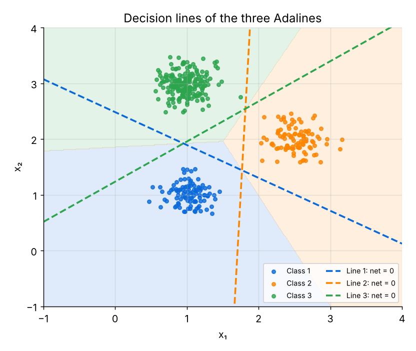

<div align="center">
  <h1>Adaline: Multi-Class Classification with the Delta Rule</h1>
  <p><i>Three linear neurons, trained with the Widrow–Hoff (LMS) rule, separate three groups of points</i></p>
</div>

---

## Project Overview

This project implements **Adaline** (*ADAptive LInear NEuron*, Widrow & Hoff, 1960) **from scratch** and uses three of them to classify three groups of 2-D points.

Adaline differs from the perceptron in one key way: the error is measured on the **linear net input**, before any threshold, so training becomes a smooth minimisation of the **Mean Squared Error (MSE)**. This is the first step toward gradient descent.


---

## Key Topics & Experiments

- Generating three **Gaussian** classes (100, 100 and 200 points, std = 0.2)
- Design of a **single-layer network**: 2 inputs, 3 Adaline output neurons
- **One-vs-rest** targets: one Adaline per class
- The **delta rule (LMS)** and the MSE learning curve
- **Decision lines** (net = 0) and the final decision regions
- **Confusion matrix** and accuracy
- Effect of the **learning rate α** on training speed and results, including divergence

---

## Technical Details

Each neuron computes

net = w₁x₁ + w₂x₂ + b

and is trained on every point with the **delta rule**:

e = t − net  
wᵢ ← wᵢ + α · e · xᵢ  
b ← b + α · e

Where:
- xᵢ = inputs, wᵢ = weights, b = bias
- t = target (**+1** for the neuron's own class, **−1** for the others)
- α = learning rate (0.00009), trained for 1000 epochs

A point is assigned to the class whose neuron has the **largest net input**.

All implementations are written in **pure Python**, without using machine learning libraries.

---

## Results

With **α = 0.00009**, **1000 epochs** and a fixed random seed:

| Neuron | Final MSE | Accuracy (one-vs-rest) |
|---|---|---|
| Neuron 1 (Class 1) | 0.058 | 100% |
| Neuron 2 (Class 2) | 0.068 | 100% |
| Neuron 3 (Class 3) | 0.058 | 100% |

The final classification (largest net input) labels **400 / 400** points correctly.

Effect of the learning rate (same initial values every time):

| α | Epochs to MSE ≤ 0.1 | Mean final MSE | Accuracy | Diverged |
|---|---|---|---|---|
| 0.000001 | never | 0.7980 | 50.5% | no |
| 0.00009 | 472 | 0.0619 | 100% | no |
| 0.001 | 47 | 0.0586 | 100% | no |
| 0.01 | never | 0.1197 | 99.8% | no |
| 0.1 | never | 0.6235 | 56.2% | no |
| 0.3 | never | huge | 25.0% | yes |

<div align="center">
  
</div>

---

## Project Structure

```
adaline-classifier/
├── Adaline.ipynb      # theory, code, experiments and results
├── README.md
├── LICENSE
├── .gitignore
└── images/            # figures used in the notebook (network, data, MSE curves, decision lines)
```

- Contains theoretical explanation
- Step-by-step code implementation
- Experimental demonstrations
- Learning curves, decision lines and confusion matrix for validation

---

## How to Run

1. Clone this repository:
```bash
   git clone https://github.com/afshars/deep-learning-from-scratch.git
```

2. Open the notebook:

- adaline-classifier/Adaline.ipynb

3. Run the cells sequentially in:

- Jupyter Notebook  
- VS Code  
- Google Colab  

No external libraries are required (Python 3.8+).

---

## Learning Outcomes

After exploring this notebook you will:

- Understand how the delta rule minimises the MSE
- See the difference between Adaline and the perceptron
- Build a multi-class classifier from several binary neurons (one-vs-rest)
- Understand how the learning rate controls speed, noise and divergence

---

## License

This project is released under the [MIT License](LICENSE).

---

## 👤 About the Author

**Sarah M Afshar**  
Python Developer specializing in Generative AI  

Focused on **Large Language Models (LLMs)**, neural network fundamentals, and intelligent system development.

🔗 GitHub: https://github.com/afshars  
🔗 LinkedIn: https://www.linkedin.com/in/sara-m-afshar/
