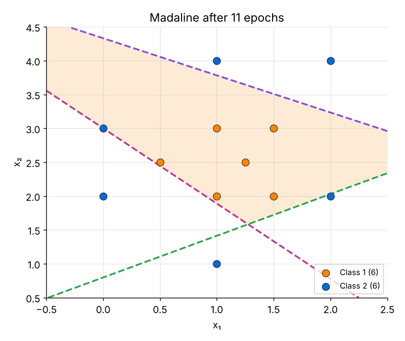

<div align="center">
  <h1>Madaline: Separating Classes with Many Adalines</h1>
  <p><i>A hidden layer of Adaline units and a fixed AND output separate a class that no single line can separate</i></p>
</div>

---

## Project Overview

This project implements **Madaline** (*Many ADAptive LINEs*, Widrow, early 1960s) **from scratch** and uses it to separate a class of points that is **surrounded** by another class.

A single perceptron or Adaline draws only one straight line. Madaline places several Adalines in a **hidden layer** and combines their outputs with a **fixed logic unit**, so it can enclose a class in a polygon-shaped region.

---

## Key Topics & Experiments

- Comparison of **Madaline with the perceptron and the Adaline**: strengths and weaknesses
- Proof that **no single line** separates the two classes (best single line: 9 of 12 points)
- Design of a network with **3 hidden Adalines** and a **fixed AND** output unit
- Training with **Madaline Rule I (MR-I)** and the separating lines it learns
- **Reliability** of the training for 1 to 5 hidden units (100 random starts each)
- **94 new Gaussian points**: separating the unbalanced data (100 vs 6 points)
- Effect of **unequal class sizes** on separability, epochs and accuracy

---

## Technical Details

Every hidden unit computes

net = w₁x₁ + w₂x₂ + b,  z = sign(net)

and the fixed output unit is an **AND** of the hidden outputs:

y = sign( z₁ + z₂ + z₃ − 2 )

So the network answers **+1** inside the intersection of three half-planes (a triangle) and **−1** everywhere else.

**Madaline Rule I (MR-I)** corrects the network only when y ≠ t:

- t = +1: every hidden unit with z = −1 is corrected
- t = −1: only the hidden unit with the net closest to 0 is corrected

The correction uses the delta rule toward the target:

wₖ ← wₖ + α · (t − netₖ) · x  
bₖ ← bₖ + α · (t − netₖ)

Where:
- x = input point, t = target (+1 for class 1, −1 for class 2)
- α = learning rate (0.05)
- Every hidden line starts with a random direction and passes near the centre of the data

All implementations are written in **pure Python**, without using machine learning libraries.

---

## Results

The 12 points of the first experiment (6 per class) are separated by 3 hidden units in **11 epochs** (100% accuracy), while the best single line reaches only 75%.

Success rate of MR-I from 100 random starts:

| Hidden units | Converged runs | Median epochs |
|---|---|---|
| 1 | 0 / 100 | - |
| 2 | 0 / 100 | - |
| 3 | 92 / 100 | 21 |
| 4 | 99 / 100 | 15 |
| 5 | 100 / 100 | 10 |

Unbalanced data (class 2 always has 6 points, 20 random starts per row):

| Points in class 1 | Majority baseline | Converged runs | Median epochs | Recall of class 2 |
|---|---|---|---|---|
| 6 | 50.0% | 20 / 20 | 19 | 100% |
| 16 | 72.7% | 20 / 20 | 16 | 100% |
| 36 | 85.7% | 19 / 20 | 18 | 99.2% |
| 100 | 94.3% | 20 / 20 | 12 | 100% |
| 206 | 97.2% | 19 / 20 | 12 | 98.3% |
| 506 | 98.8% | 20 / 20 | 15 | 100% |

The imbalance did not change the separability or the number of epochs for this compact data, but it makes plain accuracy misleading: the accuracy of each class must be checked.

<div align="center">
  
</div>

---

## Project Structure

```
madaline-classifier/
├── Madaline.ipynb     # theory, code, experiments and results
├── README.md
├── LICENSE
├── .gitignore
└── images/            # figures used in the notebook (network, data, lines, imbalance)
```

- Contains theoretical explanation
- Step-by-step code implementation
- Experimental demonstrations
- Training logs, learned lines and per-class accuracy for validation

---

## How to Run

1. Clone this repository:
```bash
   git clone https://github.com/afshars/deep-learning-from-scratch.git
```

2. Open the notebook:

- madaline-classifier/Madaline.ipynb

3. Run the cells sequentially in:

- Jupyter Notebook  
- VS Code  
- Google Colab  

No external libraries are required (Python 3.8+).

---

## Learning Outcomes

After exploring this notebook you will:

- Understand why one layer is not enough and how a hidden layer helps
- Build a polygon-shaped decision region from half-planes
- Train hidden units with Madaline Rule I and see why it has no convergence guarantee
- Understand why accuracy alone is misleading for unbalanced classes

---

## License

This project is released under the [MIT License](LICENSE).

---

## 👤 About the Author

**Sarah M Afshar**  
Python Developer specializing in Generative AI  

Focused on **Large Language Models (LLMs)**, neural network fundamentals, and intelligent system development.

🔗 GitHub: https://github.com/afshars  
🔗 LinkedIn: https://www.linkedin.com/in/sara-m-afshar/
