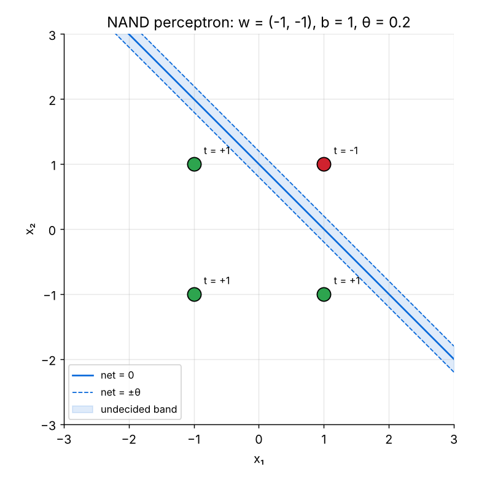

<div align="center">
  <h1>Perceptron Learning: Training a NAND Gate</h1>
  <p><i>How a single neuron learns a logic function from its own errors</i></p>
</div>

---

## 📄 Project Overview

This project implements the **perceptron** (Rosenblatt, 1958), the simplest trainable neural model, and teaches it the **NAND** gate **from scratch**.

Unlike the McCulloch–Pitts neuron, whose weights are chosen by hand, the perceptron **learns** its weights with an error-driven update rule. The notebook prints every training step, so the whole weight-update process can be followed by hand.

The project is based on **Assignment 1, Question 2** of the *Neural Networks & Deep Learning (NNDL)* course.

---

## 🧠 Key Topics & Experiments

- ✅ Training a single perceptron on the **NAND** truth table (bipolar encoding)
- ✅ Step-by-step **weight-update table** (net, output, error, Δw, new weights)
- ✅ Hand-checked walkthrough of the first training step
- ✅ **Decision boundary** and the undecided band **net = ±θ**
- ✅ Effect of **θ, α, initial bias, initial weights and pattern order** on the final solution
- ✅ Demonstration of the **XOR limitation** (no convergence)

---

## ⚙️ Technical Details

The perceptron computes

net = w₁x₁ + w₂x₂ + b

and applies a threshold activation with an undecided band of width 2θ:

y = +1  if  net > θ  
y = 0  if  −θ ≤ net ≤ θ  
y = −1  if  net < −θ

The learning rule is applied **only when y ≠ t**:

wᵢ ← wᵢ + α · t · xᵢ  
b ← b + α · t

Training stops after the first epoch in which no weight changes.

Where:
- xᵢ = inputs (bipolar: 0 → −1, 1 → +1)
- wᵢ = weights, b = bias
- θ = threshold, α = learning rate, t = target

All implementations are written in **pure Python**, without using machine learning libraries.

---

## 📊 Results

With **θ = 0.2, α = 1, b = 0, w = 0** the perceptron converges after **2 epochs** (one to learn, one to verify):

| Final weights | Value |
|---|---|
| w₁ | −1 |
| w₂ | −1 |
| b | 1 |
| Accuracy on NAND | 100% |

Other settings give other (equally correct) solutions:

| θ | α | b₀ | Epochs | (w₁, w₂) | b | Accuracy |
|---|---|---|---|---|---|---|
| 0.2 | 1 | 0 | 2 | (−1, −1) | 1 | 100% |
| 1 | 1 | 1 | 3 | (−3, −3) | 2 | 100% |
| 0.2 | 1 | −1 | 2 | (−2, −2) | 1 | 100% |
| 0.2 | 0.5 | 0 | 2 | (−0.5, −0.5) | 0.5 | 100% |
| 0.2 | 2 | 0 | 2 | (−2, −2) | 2 | 100% |
| 1.5 | 1 | 0 | 2 | (−2, −2) | 2 | 100% |

<div align="center">
  
</div>

---

## 📂 Project Structure

```
nand-perceptron/
├── NAND-Perceptron.ipynb   # theory, code, experiments and truth tables
├── README.md
├── LICENSE
├── .gitignore
└── images/                 # figures used in the notebook
```

- Contains theoretical explanation
- Step-by-step code implementation
- Experimental demonstrations
- Training and truth tables for validation

---

## 🚀 How to Run

1. Clone this repository:
```bash
   git clone https://github.com/afshars/nand-perceptron.git
```

2. Open the notebook:

- NAND-Perceptron.ipynb

3. Run the cells sequentially in:

- Jupyter Notebook  
- VS Code  
- Google Colab  

No external libraries are required (Python 3.8+).

---

## 🎯 Learning Outcomes

After exploring this notebook you will:

- Understand how a perceptron learns from its errors
- Follow every weight update of the perceptron learning rule by hand
- See why the final weights are **not unique**, even though NAND is always learned correctly
- Learn why the **XOR problem** needs a multi-layer architecture

---

## 📄 License

This project is released under the [MIT License](LICENSE).

---

## 👤 About the Author

**Sarah Afshar**  
Python Developer specializing in Generative AI  

Focused on **Large Language Models (LLMs)**, neural network fundamentals, and intelligent system development.

🔗 GitHub: https://github.com/afshars  
🔗 LinkedIn: https://www.linkedin.com/in/sara-m-afshar/
